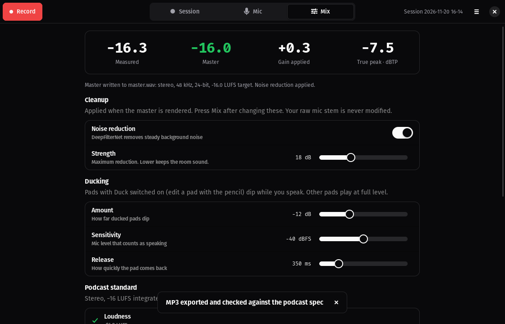

<div align="center">


# Cuebooth

**A small recording console for a USB mic.**<br>
Record the mic, fire hotkey sounds from pads, keep both on separate tracks, and export a stereo master normalized to podcast loudness.


</div>

> **Unofficial.** Cuebooth is an independent project. It is **not affiliated with, endorsed by, or sponsored by RØDE
> Microphones.** "RØDE", "PodMic" and "RØDE Central" are trademarks of their owner and are used only to describe
> compatible hardware. Nothing here is RØDE code.

## What it does

| | |
|---|---|
| 🎙 **Record** | 48 kHz, 24-bit WAV from your USB mic. Built around the RØDE PodMic USB, works with any input. |
| 🎛 **Console** | Colour-coded Mic, Hotkeys and Master faders. LED meters with a dBFS ruler and peak hold. A highlighted **0 dB unity** mark with a magnetic detent (double-click a fader to snap back). |
| 🥁 **Hotkey pads** | Eight pads, each with its own key, sound, level and colour. Hits are timestamped against the mic stream. |
| 📂 **Separate stems** | Every session is a folder: `mic.wav` (mono), `hotkeys.wav` (stereo) and `master.wav`. Normalization never touches the stems. |
| 📏 **Podcast master** | Stereo, **−16 LUFS** integrated, **true peak ≤ −1 dBTP** (4× oversampled, so inter-sample overs are caught). A compliance panel shows the result. |
| 💿 **MP3 export** | 128 kbps MP3 for distribution. It decodes its own output and re-limits if encoding pushed the peak over the ceiling. |
| 🔧 **Mic DSP** | Controls the PodMic's on-board processing without RØDE Central. See below. |

<div align="center">

</div>

## Install

```bash
sudo apt install python3-gi gir1.2-gtk-4.0 gir1.2-adw-1 gir1.2-gstreamer-1.0 \
                 gstreamer1.0-plugins-good gstreamer1.0-pulseaudio   # once
./install.sh                                                          # no sudo; installs to ~/.local
cuebooth
```

Needs Python 3.10+, GTK 4, libadwaita 1.5+ and GStreamer. Sessions are saved in `~/Music/Cuebooth/`.

## Using it

1. Pick the input (the PodMic is chosen automatically) and set the Hotkeys pads. Click a pad's ✎ to choose a sound, key and colour. Any audio format works; sounds are converted to 48 kHz stereo WAV and kept in the session.
2. **Ctrl+R** (or REC) starts and stops. Press a pad's key at any time. Hits are logged while recording.
3. On stop, the master is mixed and normalized automatically. Adjust the Mic and Hotkeys faders and press **MIX** to remix. The mic stem is always recorded clean.
4. Open the **Mix** tab to check the result against the podcast standard and **Export MP3**.

Keys work while Cuebooth is focused. System-wide hotkeys are not implemented yet (Wayland needs the GlobalShortcuts portal).

## Mic DSP (PodMic USB)

RØDE Central doesn't run on Linux, so Cuebooth talks to the mic directly over USB HID, using the protocol reverse-engineered by
[podmicusb-doctor](https://github.com/rumkit/podmicusb-doctor) (MIT). It covers input gain, mute, direct monitoring, the high-pass
filter, Depth / Sparkle / Punch, and the advanced compressor, noise gate, Aural Exciter and Big Bottom.

Gain works out of the box. The rest needs a one-time permission for the HID device:

```bash
sudo install -m644 data/70-cuebooth-podmic.rules /etc/udev/rules.d/ \
  && sudo udevadm control --reload && sudo udevadm trigger --subsystem-match=hidraw
```

The Mic tab shows this command (with a copy button) when it's needed.

**Status:** the encoders are unit-tested against the byte sequences captured in the protocol research, and the app reads gain from real
hardware. Writing DSP parameters to a physical mic has not yet been verified end to end by the author. Treat it as beta and
please report what you see. Settings are stored in the mic itself and survive power cycles.

## Development

```bash
uv venv --system-site-packages && uv pip install -e ".[dev]"
.venv/bin/python -m pytest
.venv/bin/python -m cuebooth
```

## Credits

- Protocol research and DSP tables: [rumkit/podmicusb-doctor](https://github.com/rumkit/podmicusb-doctor) (MIT). See [NOTICE](NOTICE).
- Layout and packaging approach: [netaudio-desktop](https://github.com/thetylerwoodwardproject/netaudio-desktop).
- Loudness measurement: [pyloudnorm](https://github.com/csteinmetz1/pyloudnorm) (ITU-R BS.1770).

MIT licensed.
