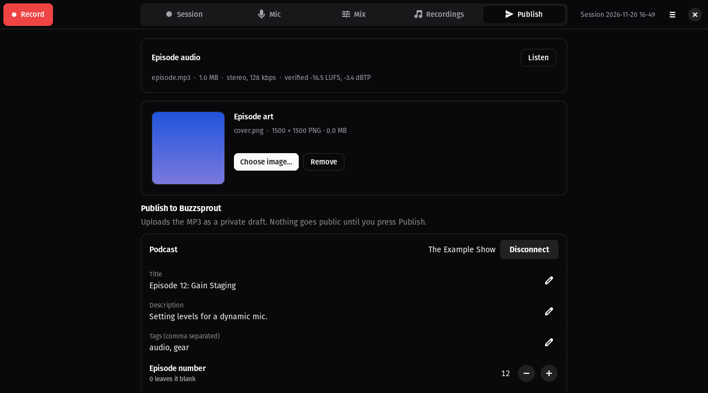
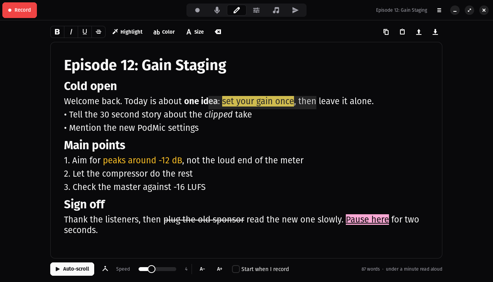
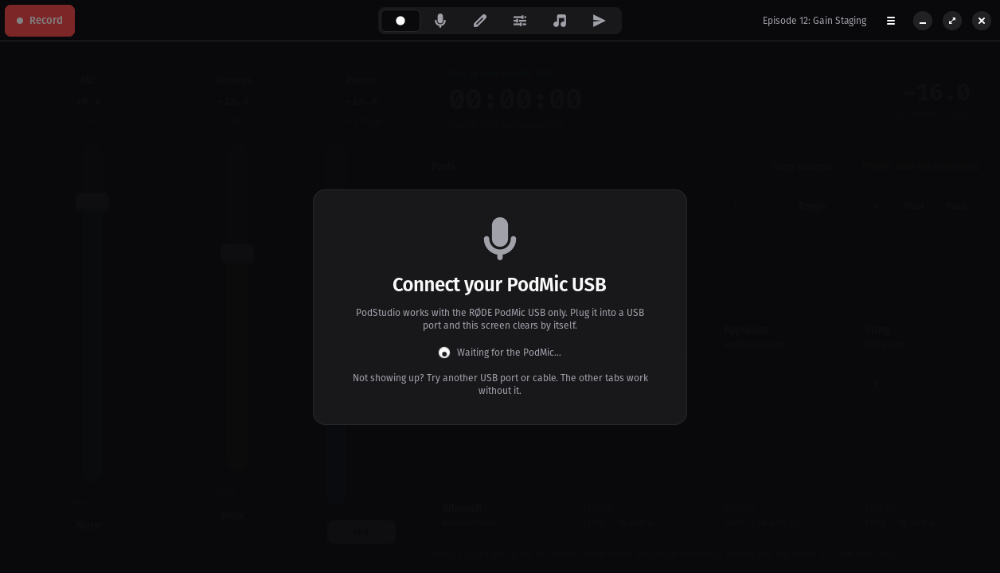
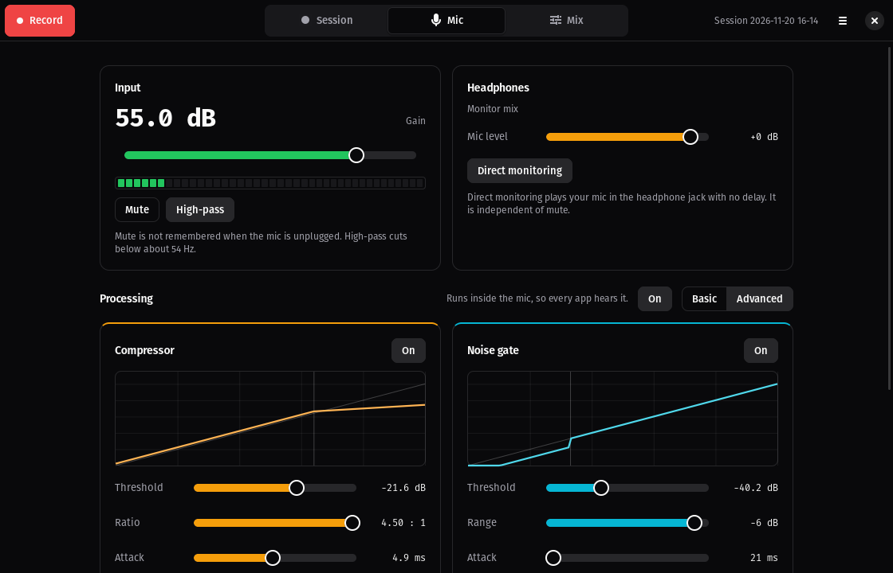

<div align="center">


# PodStudio

**A recording console for the RØDE PodMic USB.**<br>
Record the mic, fire hotkey sounds from pads onto their own track, clean up the noise, and export a podcast-loudness master. Then send it to Buzzsprout as a private draft.


</div>

> **Unofficial.** PodStudio is an independent project. It is **not affiliated with, endorsed by, or sponsored by RØDE
> Microphones.** "RØDE", "PodMic" and "RØDE Central" are trademarks of their owner and are used only to describe the
> hardware this software works with. Nothing here is RØDE code. **PodStudio works with the PodMic USB only.**

## What it does

| | |
|---|---|
| 🎙 **Record** | 48 kHz, 24-bit WAV straight from the PodMic USB. Plug-and-play, hot-plug aware. If the mic disconnects mid-take, the take is repaired and kept. |
| 🎛 **Console** | Colour-coded Mic, Hotkeys and Master faders with LED meters, a dBFS ruler, peak hold, and a highlighted **0 dB unity** mark with a detent. The Mic fader moves the meter live and sets the mic-versus-hotkeys balance. |
| 🥁 **Hotkey pads** | Eight pads, each with its own key, sound, level and colour, and a **button mode**: *One-shot*, *Hold* (plays while pressed), *Toggle*, or *Loop* (seamless). New sounds are level-matched so they sit with your voice, the hotkeys fader moves sounds that are already playing, and its meter shows the real signal. Hits (and how long they were held or looped) are timestamped against the mic stream. |
| 📉 **Ducking** | Switch **Duck** on for the pads that should dip under your voice, and leave the rest alone. Applied live and in the master, with look-ahead so the first syllable isn't covered. |
| 🔇 **Noise reduction** | [DeepFilterNet](https://github.com/Rikorose/DeepFilterNet) runs on the mic stem when the master is rendered (it's too heavy to run live, but processes audio about 10× faster than real time). Strength is adjustable. Your raw mic stem is never modified. |
| 🎧 **Recordings** | Preview every session without leaving the app: a waveform player for the master, mic, cleaned mic, hotkeys and MP3, with hotkey hits marked on the timeline. Switching stems keeps your place, so you can A/B raw against cleaned. |
| 🔖 **Chapters** | Press *Add chapter here* while you listen. Chapters are shown on the waveform and uploaded with the episode. |
| 📂 **Separate stems** | Each session is a folder: `mic.wav`, `mic-clean.wav`, `hotkeys.wav` and `master.wav`. Hotkeys and mic are never baked together except in the master. |
| 📏 **Podcast master** | Stereo, **−16 LUFS** integrated, **true peak ≤ −1 dBTP** (4× oversampled, so inter-sample overs are caught), with a pass/fail check on the Mix page. |
| 📝 **Script tab** | A place for the script, notes or an outline, with formatting, auto-scroll like a teleprompter, copy and paste, and file import. Saved with the session. |
| 💿 **MP3 export** | 128 kbps MP3 that decodes its own output to confirm it still meets the spec. |
| 📡 **Buzzsprout** | Direct API upload as a **private draft**, with your own **episode art** and chapters. Publishing is a separate, confirmed step. |
| 🔧 **Mic DSP** | Controls the PodMic's on-board processing (see below) without RØDE Central. |

<div align="center">
 
 
</div>

## Install

Download the installer for your system from the **[Releases page](https://github.com/thetylerwoodwardproject/podstudio/releases)**.

| System | Download | Notes |
|---|---|---|
| **Windows 10 / 11** (64-bit) | **[Latest Windows release](https://github.com/thetylerwoodwardproject/podstudio/releases/tag/v2026.11.20-8)**: `PodStudio-<version>-x64-setup.exe` | About 15 MB. Installs for your user (no administrator prompt) and upgrades over the earlier Python build. A portable `.zip` is there too. |
| **Debian / Ubuntu / Pop!_OS** (24.04 or newer, amd64) | **[Linux release](https://github.com/thetylerwoodwardproject/podstudio/releases/tag/v2026.11.20-7)**: the `.deb`, the Flatpak or the AppImage | The `.deb` is the most tested. |

Every file has a `.sha256` next to it, so you can check the download.

**Windows.** Run the setup file. The installer isn't code-signed, so Windows SmartScreen says "Windows protected your PC" the first
time: choose *More info*, then *Run anyway*. Your sessions in `Music\PodStudio` are never touched, and they open in the Linux app too. This is a
native C++ app (see [native/README.md](native/README.md)). It is built and tested on Windows for every release, but it has **not yet been used with a
real PodMic on Windows**: see "Not done yet" in that file.

**Linux.**

```bash
sudo apt install ./podstudio_<version>_amd64.deb            # the .deb pulls in its dependencies and the mic permission rule
flatpak install --user PodStudio-<version>.flatpak          # or the Flatpak
chmod +x PodStudio-<version>-x86_64.AppImage && ./PodStudio-<version>-x86_64.AppImage     # or the AppImage
```

For the Mic tab's on-board controls, the Flatpak and AppImage need a one-time udev rule on the host (the app shows the command).
Everything else works without it. To check any Linux install, run `podstudio --self-test`.

Sessions are saved in `~/Music/PodStudio/` (`Music\PodStudio` on Windows). Versions are dates: **v2026.11.20** is the 20th of November 2026, and a
rebuild of the same date gets a revision (`2026.11.20-8`).

<details><summary>Build it yourself</summary>

```bash
./packaging/build-deb.sh            # Debian-family .deb, output in dist/
./packaging/build-appimage.sh       # AppImage
flatpak run org.flatpak.Builder --user --install --force-clean build/flatpak-build packaging/flatpak/io.github.thetylerwoodwardproject.PodStudio.yml
```

Per-user install from a source checkout, no sudo:

```bash
sudo apt install python3-gi gir1.2-gtk-4.0 gir1.2-adw-1 gir1.2-gstreamer-1.0 gir1.2-secret-1 \
                 gstreamer1.0-plugins-good gstreamer1.0-plugins-base alsa-utils pulseaudio-utils   # once
./install.sh              # installs to ~/.local and fetches DeepFilterNet (--no-deepfilter to skip)
./install.sh --uninstall  # remove it again (do this after installing the .deb)
```

The Windows app is built with CMake: see [native/README.md](native/README.md). What was tested for each Linux format is in
[packaging/README.md](packaging/README.md).
</details>

## Using it

1. Plug in the PodMic USB. The header shows it as connected.
2. Set up your pads: click a pad's ✎ to choose a sound, key, colour, **button mode**, and whether it ducks under your voice.
3. **Ctrl+R** (or Record) starts and stops. Press a pad's key at any time. Hits are logged while recording.
4. On stop, the master is mixed and normalized automatically. On the **Mix** tab you can turn noise reduction on or off, tune ducking, and **Render master** again after any change.
5. Listen on the **Recordings** tab (Space plays and pauses, ←/→ skip 5 s) and add chapters where sections start.
6. On the **Publish** tab, add cover art, then upload the draft to Buzzsprout.

Keys work while PodStudio is focused. System-wide hotkeys aren't implemented yet (Wayland needs the GlobalShortcuts portal).

## The Script tab

A page for the script, notes or an outline. It saves with the session and the next take starts with a copy.

- **Formatting:** bold, italic, underline, strike-through, five highlight colors, five text colors, and heading, subheading and small sizes. Ctrl+B, Ctrl+I, Ctrl+U, Ctrl+Shift+X (strike-through) and Ctrl+Shift+H (highlight) work as you'd expect. Pick a format with nothing selected and it applies to what you type next. Typing at the end of bold text carries on in bold.
- **Auto-scroll:** the Auto-scroll button (or **F8**) scrolls the script like a teleprompter. Speed runs from 1 to 10. While it runs, Space pauses, Up and Down change the speed, and Home goes back to the top. Tick **Start when I record** and it scrolls from the top when a take starts and stops when the take ends. The text size (A− and A+) and speed are remembered.
- **Copy and paste:** the usual shortcuts, plus buttons. Copy takes the selection, or the whole script if nothing is selected. Pasted text comes in as plain text.
- **Import and export:** import `.txt`, `.md` or Word `.docx` files, by the Import button or by dropping the file on the page. Markdown headings, bold, italic, underline, strike-through and `==highlight==` come across, and Word headings, runs and highlights too. If there's already text you're asked whether to replace it or add the new text to the end. Export writes Markdown (formatting kept, except colors, which Markdown has no form for) or plain text.
- A script is stored as `script.json` in the session folder, with a `.bak` of the last good copy. Nothing is created until you actually type or import something.

## Connecting the mic

PodStudio only works with the RØDE PodMic USB. If it can't find the mic when it starts, the Session tab is covered by a "Connect your PodMic USB" screen and nothing on it can be used until the mic is plugged in. The screen clears by itself within a couple of seconds. It never covers a take that is already recording, and every other tab (Mic, Script, Mix, Recordings, Publish) works without the mic.

<div align="center"></div>

## Updates

PodStudio checks GitHub for a newer release about once a day and shows an **Update available** badge in the header. Open it to read the release notes, then **Download and install**. You can also use the menu: **Check for Updates…**, or turn off **Check automatically**.

- The check is an anonymous request to this project's GitHub releases. It sends no account, device or usage information.
- An update is only installed if the release publishes a SHA-256 checksum and the download matches it. Downloads must come from GitHub's own hosts over HTTPS, and redirects anywhere else are refused.
- Installing goes through your system's normal password prompt. It never happens silently, and never while you are recording.
- A copy that wasn't installed from the .deb just links to the release page.
- **Windows:** the app checks a few seconds after it starts, and you can check any time from the session menu (top right, then **Check for updates**). It downloads the setup file, checks it against its published checksum, then closes, updates and reopens itself. This only works for a copy installed with the setup program (not the portable zip).

<details><summary>Publishing a release</summary>

Installers live on the Releases page. The tag is `v` plus the version and revision (`v2026.11.20-8`), which is how installed copies tell that a release is newer.

- **Windows** is published by CI. Push a commit whose message contains `[release]`, or push a `v*` tag, and the `native-windows` job builds the app, runs the tests, and attaches `PodStudio-<version>-x64-setup.exe`, the portable zip and their `.sha256` files to the release (it creates the release if needed). To ship a new build, raise `packaging/revision` (or the date in `podstudio/__init__.py`) first.
- **Linux** packages are built with `./packaging/build-deb.sh` (and the AppImage and Flatpak scripts) and attached by hand, or by the same workflow on a tag:

```bash
gh release create "v<version>" dist/podstudio_<version>_amd64.deb dist/podstudio_<version>_amd64.deb.sha256 \
  --title "PodStudio v<version>" --notes "What changed"
```

Don't mark a release as a pre-release or draft: installed copies deliberately ignore those. Each installer needs its `.sha256` beside it, or the updater won't install it.
</details>

## If something goes wrong: recovering a session

Recording is built so a crash or power cut doesn't lose the take.

- **Hotkey hits are written to a journal as you press them**, and the session is marked "recording" on disk. If PodStudio dies mid-take, the next launch offers to **recover** it: the audio is repaired (a killed recording never gets its final header), the hits are replayed, and you're back to a normal session. Only the last fraction of a second that was still in memory is lost.
- **The session file keeps an automatic backup** (`project.json.bak`). If it is damaged, recovery restores your settings from the backup and keeps the damaged file next to it. If it is missing entirely, the session is rebuilt from the audio, and the pads are worked out from the hits.
- The **Recordings** tab marks any session that needs this with a **Needs recovery** badge and a **Recover** button. **Recover from folder…** repairs a session that isn't in the list at all.
- Recovery never deletes anything, and a healthy session is left as it is.

## Buzzsprout

<details><summary>How publishing works</summary>

Paste your API token (Buzzsprout: Profile → API) on the Mix tab. It is kept in your desktop keyring (libsecret) and is never written to a file. If no keyring is available, the token lasts for the session only.

- **Upload draft** creates a *private* episode, uploads your cover art (only when it changed), uploads the MP3 (Buzzsprout's start, PUT, complete flow), waits for encoding, then sets the chapters. Uploading again updates the same draft. Chapters are tidied first (sorted, and an "Intro" added at 0:00 if the first one starts later, which podcast apps expect), and you are told about any change.
- **Artwork** should be a square JPEG or PNG, 1400 to 3000 px. Other sizes are allowed with a warning.
- **Publish…** asks for confirmation, then makes the episode public. It is the only thing that does.
- The token goes only to Buzzsprout's API: never to the upload host and never across redirects. PodStudio identifies itself with a generic `PodStudio/<version>` User-Agent.
</details>

## Mic DSP (PodMic USB)

<div align="center">
 
</div>

RØDE Central doesn't run on Linux, so PodStudio talks to the mic directly over USB HID, using the protocol reverse-engineered by
[podmicusb-doctor](https://github.com/rumkit/podmicusb-doctor) (MIT). It covers input gain, mute, direct monitoring, the high-pass
filter, Depth / Sparkle / Punch, and the advanced compressor, noise gate, Aural Exciter and Big Bottom. Gain works with no setup. The
rest needs permission for the HID device, which the .deb installs. For a per-user install:

```bash
sudo install -m644 data/70-podstudio-podmic.rules /etc/udev/rules.d/ \
  && sudo udevadm control --reload && sudo udevadm trigger --subsystem-match=hidraw
```

**Status:** tested on a real PodMic USB. Gain, mute, direct monitoring, high-pass, Basic/Advanced mode and individual compressor and gate
values write and read back correctly, and the settings are stored in the mic. Not every advanced field has been checked by ear yet, so
treat the Advanced cards as beta.

## Development

```bash
uv venv --system-site-packages && uv pip install -e ".[dev]"
.venv/bin/python -m pytest          # 40+ tests, including a mock Buzzsprout server
.venv/bin/python -m podstudio
```

## Credits

- Protocol research and DSP tables: [rumkit/podmicusb-doctor](https://github.com/rumkit/podmicusb-doctor) (MIT).
- Noise reduction: [DeepFilterNet](https://github.com/Rikorose/DeepFilterNet) by Hendrik Schröter (MIT or Apache-2.0), bundled unmodified in the .deb.
- Visual style inspired by [shadcn/ui](https://ui.shadcn.com) (MIT). App structure from [netaudio-desktop](https://github.com/thetylerwoodwardproject/netaudio-desktop).
- Loudness follows ITU-R BS.1770-4.

See [NOTICE](NOTICE). MIT licensed.
