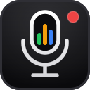
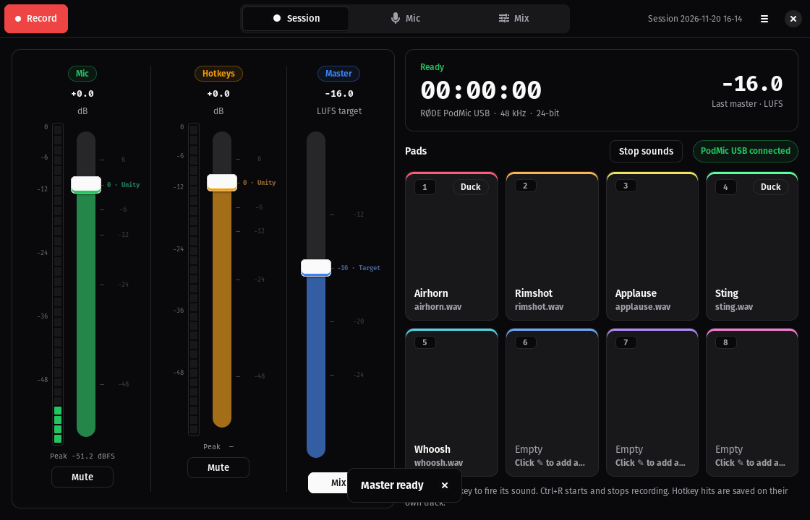
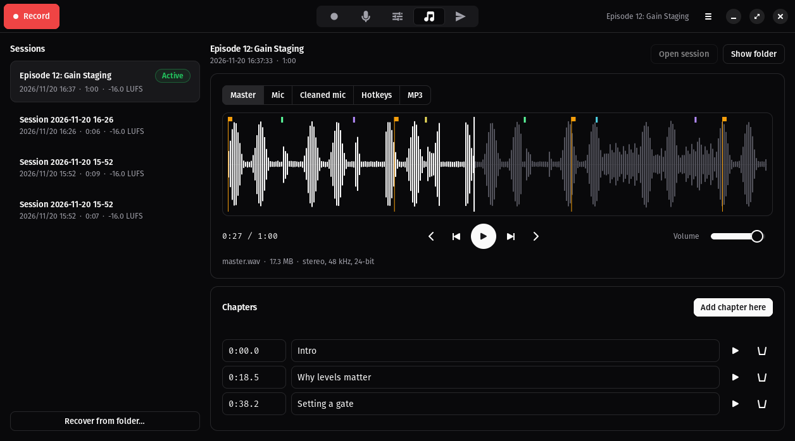
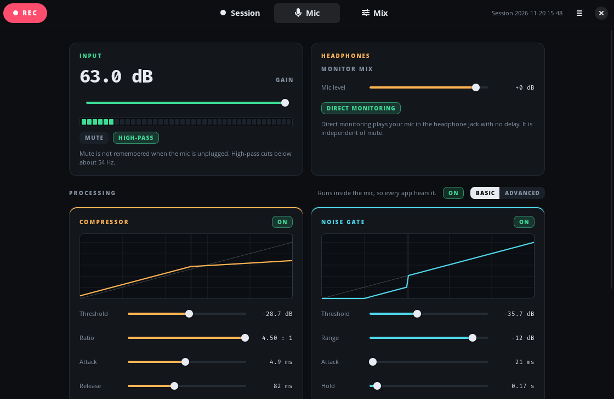

<div align="center">



# PodStudio

**A recording console for the RØDE PodMic USB.**<br>
Record the mic, fire hotkey sounds from pads onto their own track, clean up the noise, and export a podcast-loudness master. Then send it to Buzzsprout as a private draft.




</div>

> **Unofficial.** PodStudio is an independent project. It is **not affiliated with, endorsed by, or sponsored by RØDE
> Microphones.** "RØDE", "PodMic" and "RØDE Central" are trademarks of their owner and are used only to describe the
> hardware this software works with. Nothing here is RØDE code. **PodStudio works with the PodMic USB only.**

## What it does

| | |
|---|---|
| 🎙 **Record** | 48 kHz, 24-bit WAV straight from the PodMic USB. Plug-and-play, hot-plug aware. If the mic disconnects mid-take, the take is repaired and kept. |
| 🎛 **Console** | Colour-coded Mic, Hotkeys and Master faders with LED meters, a dBFS ruler, peak hold, and a highlighted **0 dB unity** mark with a detent. The Mic fader moves the meter live and sets the mic-versus-hotkeys balance. |
| 🥁 **Hotkey pads** | Eight pads, each with its own key, sound, level and colour, and a **button mode**: *One-shot*, *Hold* (plays while pressed), *Toggle*, or *Loop* (seamless). New sounds are level-matched so they sit with your voice, the hotkeys fader moves sounds that are already playing, and its meter shows the real signal. Hits (and how long they were held or looped) are timestamped against the mic stream. |
| 📉 **Ducking** | Switch **Duck** on for the pads that should dip under your voice, and leave the rest alone. Applied live and in the master, with look-ahead so the first syllable isn't covered. |
| 🔇 **Noise reduction** | [DeepFilterNet](https://github.com/Rikorose/DeepFilterNet) runs on the mic stem when the master is rendered (it's too heavy to run live, but processes audio about 10× faster than real time). Strength is adjustable. Your raw mic stem is never modified. |
| 🎧 **Recordings** | Preview every session without leaving the app: a waveform player for the master, mic, cleaned mic, hotkeys and MP3, with hotkey hits marked on the timeline. Switching stems keeps your place, so you can A/B raw against cleaned. |
| 🔖 **Chapters** | Press *Add chapter here* while you listen. Chapters are shown on the waveform and uploaded with the episode. |
| 📂 **Separate stems** | Each session is a folder: `mic.wav`, `mic-clean.wav`, `hotkeys.wav` and `master.wav`. Hotkeys and mic are never baked together except in the master. |
| 📏 **Podcast master** | Stereo, **−16 LUFS** integrated, **true peak ≤ −1 dBTP** (4× oversampled, so inter-sample overs are caught), with a pass/fail check on the Mix page. |
| 💿 **MP3 export** | 128 kbps MP3 that decodes its own output to confirm it still meets the spec. |
| 📡 **Buzzsprout** | Direct API upload as a **private draft**, with your own **episode art** and chapters. Publishing is a separate, confirmed step. |
| 🔧 **Mic DSP** | Controls the PodMic's on-board processing (see below) without RØDE Central. |

<div align="center">
 

</div>

## Install

PodStudio comes as a `.deb`, a Flatpak, an AppImage and a Snap. They are not equally proven, so see [packaging/README.md](packaging/README.md)
for exactly what was tested. Whichever you use, run `podstudio --self-test` to check an install.

**Debian / Ubuntu / Pop!_OS (24.04 or newer): the .deb** (the most tested)

```bash
sudo apt install ./dist/podstudio_*_amd64.deb      # or ./podstudio_<version>_amd64.deb
```

It pulls in its dependencies, bundles DeepFilterNet, and installs the udev rule so the mic controls work straight away.
Build it yourself with `./packaging/build-deb.sh` (output in `dist/`).

**Flatpak** (built and self-tested; the mic itself is untested in the sandbox)

```bash
flatpak run org.flatpak.Builder --user --install --force-clean build/flatpak-build packaging/flatpak/io.github.thetylerwoodwardproject.PodStudio.yml
flatpak run io.github.thetylerwoodwardproject.PodStudio
```

**AppImage** (`./packaging/build-appimage.sh`) and **Snap** (`snapcraft`, recipe in `snap/`) are described in [packaging/README.md](packaging/README.md).

For the Mic tab's on-board controls, the Flatpak, AppImage and Snap need the udev rule installed on the host (the app shows the
command). Everything else works without it.

**Per-user, no sudo**

```bash
sudo apt install python3-gi gir1.2-gtk-4.0 gir1.2-adw-1 gir1.2-gstreamer-1.0 gir1.2-secret-1 \
                 gstreamer1.0-plugins-good gstreamer1.0-plugins-base alsa-utils pulseaudio-utils   # once
./install.sh              # installs to ~/.local and fetches DeepFilterNet (--no-deepfilter to skip)
./install.sh --uninstall  # remove it again (do this after installing the .deb)
```

Sessions are saved in `~/Music/PodStudio/`. Versions are dates: **v2026.11.20** is the 20th of November 2026. A rebuilt package for the same date gets a revision (`2026.11.20-2`) so `apt` treats it as an upgrade.

## Using it

1. Plug in the PodMic USB. The header shows it as connected.
2. Set up your pads: click a pad's ✎ to choose a sound, key, colour, **button mode**, and whether it ducks under your voice.
3. **Ctrl+R** (or Record) starts and stops. Press a pad's key at any time. Hits are logged while recording.
4. On stop, the master is mixed and normalized automatically. On the **Mix** tab you can turn noise reduction on or off, tune ducking, and **Render master** again after any change.
5. Listen on the **Recordings** tab (Space plays and pauses, ←/→ skip 5 s) and add chapters where sections start.
6. On the **Publish** tab, add cover art, then upload the draft to Buzzsprout.

Keys work while PodStudio is focused. System-wide hotkeys aren't implemented yet (Wayland needs the GlobalShortcuts portal).

## Updates

PodStudio checks GitHub for a newer release about once a day and shows an **Update available** badge in the header. Open it to read the release notes, then **Download and install**. You can also use the menu: **Check for Updates…**, or turn off **Check automatically**.

- The check is an anonymous request to this project's GitHub releases. It sends no account, device or usage information.
- An update is only installed if the release publishes a SHA-256 checksum and the download matches it. Downloads must come from GitHub's own hosts over HTTPS, and redirects anywhere else are refused.
- Installing goes through your system's normal password prompt. It never happens silently, and never while you are recording.
- A copy that wasn't installed from the .deb just links to the release page.

<details><summary>Publishing a release</summary>

Build, then upload the package **and its checksum**. The tag is `v` plus the package version, which is how installed copies tell a release is newer:

```bash
./packaging/build-deb.sh            # writes dist/podstudio_<version>_amd64.deb and a .sha256 next to it
gh release create "v$(dpkg-deb -f dist/podstudio_*.deb Version)" dist/podstudio_*_amd64.deb dist/podstudio_*_amd64.deb.sha256 \
  --title "PodStudio v<version>" --notes "What changed"
```
</details>

## If something goes wrong: recovering a session

Recording is built so a crash or power cut doesn't lose the take.

- **Hotkey hits are written to a journal as you press them**, and the session is marked "recording" on disk. If PodStudio dies mid-take, the next launch offers to **recover** it: the audio is repaired (a killed recording never gets its final header), the hits are replayed, and you're back to a normal session. Only the last fraction of a second that was still in memory is lost.
- **The session file keeps an automatic backup** (`project.json.bak`). If it is damaged, recovery restores your settings from the backup and keeps the damaged file next to it. If it is missing entirely, the session is rebuilt from the audio, and the pads are worked out from the hits.
- The **Recordings** tab marks any session that needs this with a **Needs recovery** badge and a **Recover** button. **Recover from folder…** repairs a session that isn't in the list at all.
- Recovery never deletes anything, and a healthy session is left as it is.

## Buzzsprout

<details><summary>How publishing works</summary>

Paste your API token (Buzzsprout: Profile → API) on the Mix tab. It is kept in your desktop keyring (libsecret) and is never written to a file. If no keyring is available, the token lasts for the session only.

- **Upload draft** creates a *private* episode, uploads your cover art (only when it changed), uploads the MP3 (Buzzsprout's start, PUT, complete flow), waits for encoding, then sets the chapters. Uploading again updates the same draft. Chapters are tidied first (sorted, and an "Intro" added at 0:00 if the first one starts later, which podcast apps expect), and you are told about any change.
- **Artwork** should be a square JPEG or PNG, 1400 to 3000 px. Other sizes are allowed with a warning.
- **Publish…** asks for confirmation, then makes the episode public. It is the only thing that does.
- The token goes only to Buzzsprout's API: never to the upload host and never across redirects. PodStudio identifies itself with a generic `PodStudio/<version>` User-Agent.
</details>

## Mic DSP (PodMic USB)

<div align="center">
 
</div>

RØDE Central doesn't run on Linux, so PodStudio talks to the mic directly over USB HID, using the protocol reverse-engineered by
[podmicusb-doctor](https://github.com/rumkit/podmicusb-doctor) (MIT). It covers input gain, mute, direct monitoring, the high-pass
filter, Depth / Sparkle / Punch, and the advanced compressor, noise gate, Aural Exciter and Big Bottom. Gain works with no setup. The
rest needs permission for the HID device, which the .deb installs. For a per-user install:

```bash
sudo install -m644 data/70-podstudio-podmic.rules /etc/udev/rules.d/ \
  && sudo udevadm control --reload && sudo udevadm trigger --subsystem-match=hidraw
```

**Status:** tested on a real PodMic USB. Gain, mute, direct monitoring, high-pass, Basic/Advanced mode and individual compressor and gate
values write and read back correctly, and the settings are stored in the mic. Not every advanced field has been checked by ear yet, so
treat the Advanced cards as beta.

## Development

```bash
uv venv --system-site-packages && uv pip install -e ".[dev]"
.venv/bin/python -m pytest          # 40+ tests, including a mock Buzzsprout server
.venv/bin/python -m podstudio
```

## Credits

- Protocol research and DSP tables: [rumkit/podmicusb-doctor](https://github.com/rumkit/podmicusb-doctor) (MIT).
- Noise reduction: [DeepFilterNet](https://github.com/Rikorose/DeepFilterNet) by Hendrik Schröter (MIT or Apache-2.0), bundled unmodified in the .deb.
- Visual style inspired by [shadcn/ui](https://ui.shadcn.com) (MIT). App structure from [netaudio-desktop](https://github.com/thetylerwoodwardproject/netaudio-desktop).
- Loudness follows ITU-R BS.1770-4.

See [NOTICE](NOTICE). MIT licensed.
