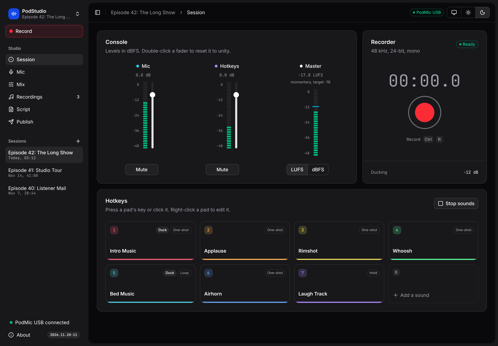
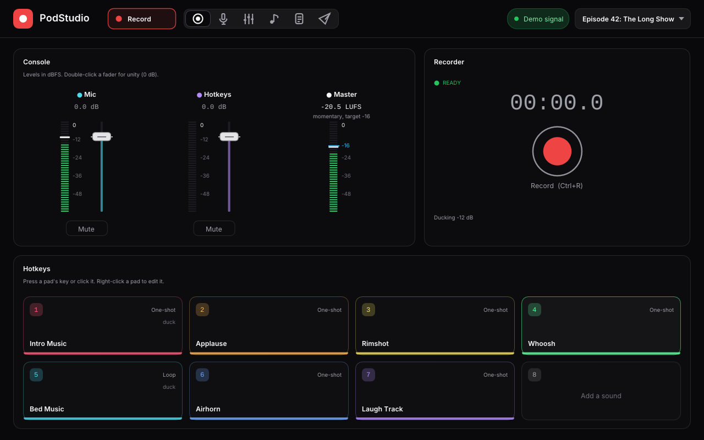
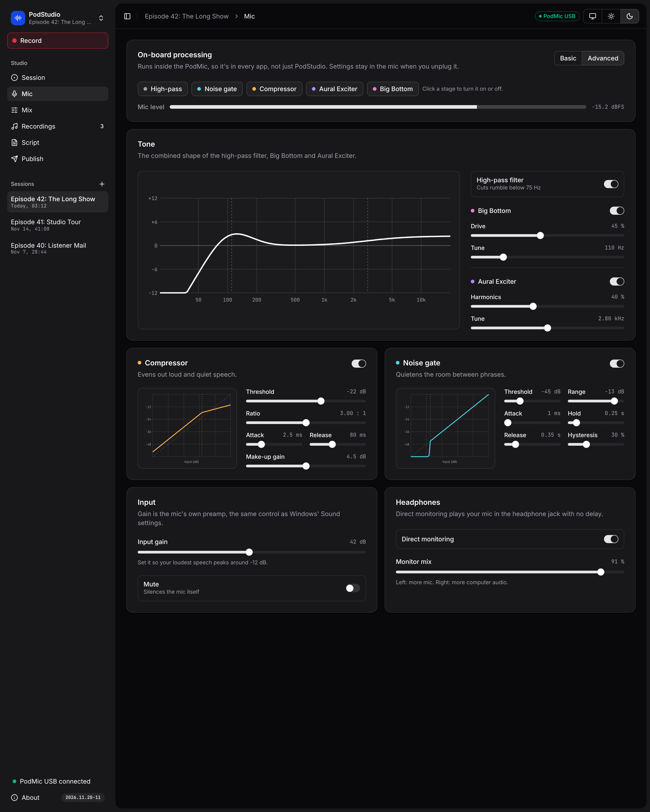
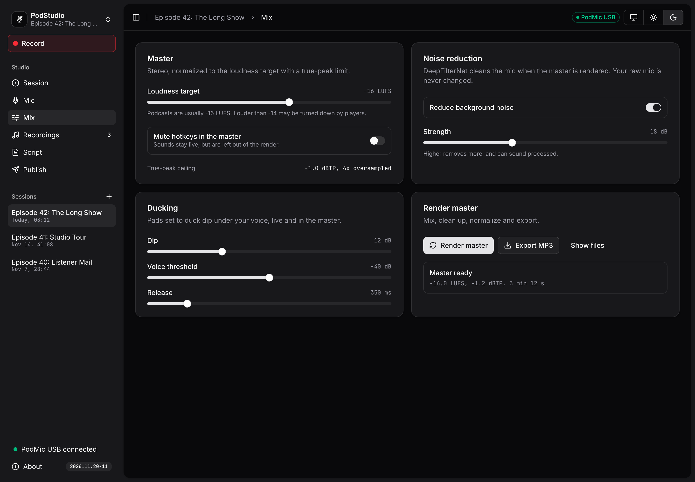
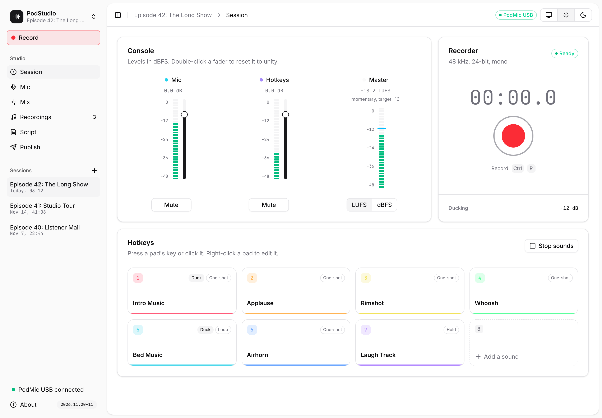
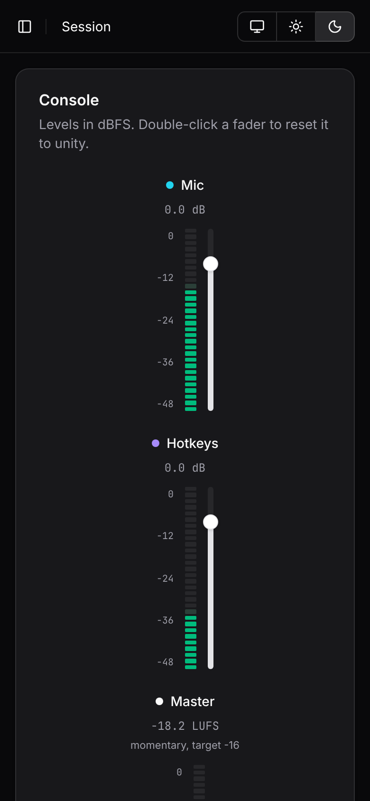

# PodStudio

**A recording console for the RØDE PodMic USB.** 
Record, add hotkey sounds, clean up the noise, export a podcast master, and send it to Buzzsprout.

[Download](#download) ·
[Features](#features) ·
[Roadmap](#roadmap) ·
[Docs](docs) ·
[Mockup](docs/mockup)

> [!NOTE]
> **Unofficial.** Not affiliated with or endorsed by RØDE Microphones. Works with the PodMic USB only.
> The images here are the design [mockup](docs/mockup) the native app is being restyled to match.

## Download

**[Get PodStudio from Releases](https://github.com/thetylerwoodwardproject/podstudio/releases)**

Windows today: download the `setup.exe` and run it. If Windows warns that it's unsigned, choose *More info*, then *Run anyway*. macOS and Linux are next (see the roadmap).

 The current Windows app, before the redesign.

## Features

| | |
|---|---|
| 🎙️ **Record the PodMic** | 48 kHz, 24-bit, with live meters and a loudness (LUFS) meter. |
| 🎹 **Hotkey sounds** | Eight pads for sound effects, on their own track, with ducking under your voice. |
| ✨ **Clean master** | Renders a −16 LUFS master with optional noise reduction, and exports an MP3. |
| 📤 **Publish** | Plays back with chapters, and uploads a private draft to Buzzsprout. |
| 🎛️ **Mic control** | Controls the mic's on-board processing. |

<table>
  <tr>
    <td width="30%"></td>
    <td width="30%"></td>
    <td width="30%"></td>
    <td width="10%"></td>
  </tr>
  <tr>
    <td align="center"><b>Mic</b></td>
    <td align="center"><b>Mix</b></td>
    <td align="center"><b>Session (light)</b></td>
    <td align="center"><b>Phone</b></td>
  </tr>
</table>

## Roadmap

| | |
|---|---|
| **Now** | **macOS** (Apple silicon): Metal, CoreAudio, IOKit, Keychain, a signed and notarized `.dmg`. |
| **Next** | **Linux** as a `.deb` for Debian and Ubuntu (and Mint, Pop!_OS). |
| **Later** | The sidebar redesign, an advanced mic screen, re-mastering old recordings, more podcast hosts (rss.com, transistor.fm), and a prompter that follows what you say. |

Full roadmap: [`docs/ROADMAP.md`](docs/ROADMAP.md).

## Documentation

- [Roadmap](docs/ROADMAP.md)
- [Mockup](docs/mockup), a clickable shadcn/ui design reference
- [Building from source](native/README.md)

## Credits

Third-party notices are in [NOTICE](NOTICE).

## Licence

[MIT](LICENSE).
