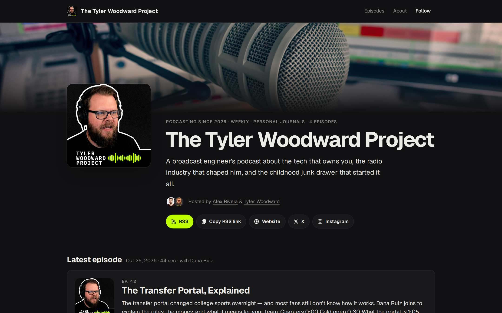
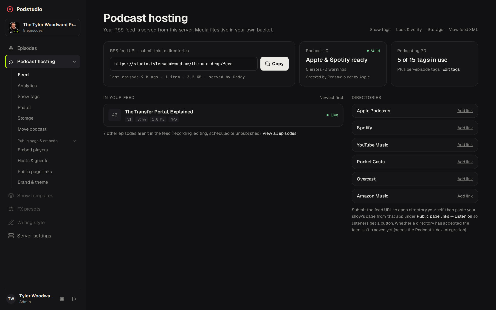
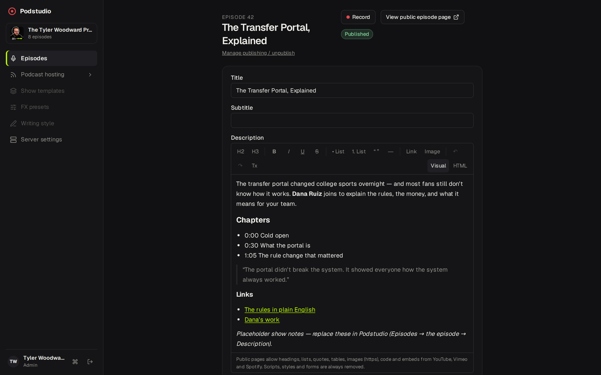
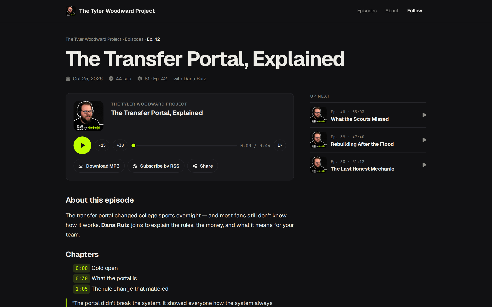
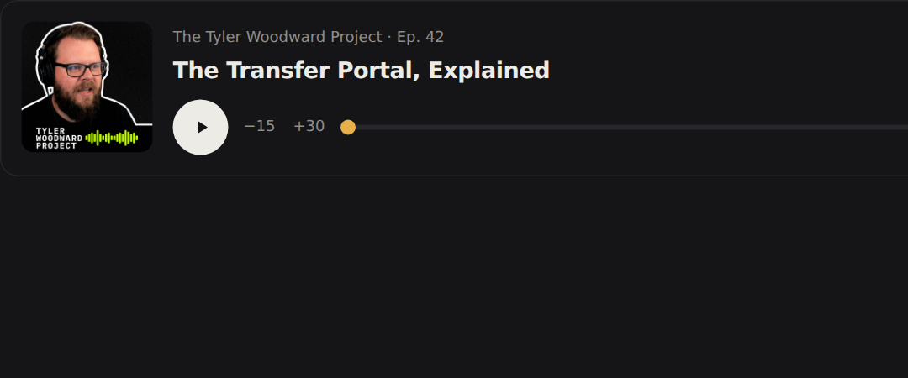
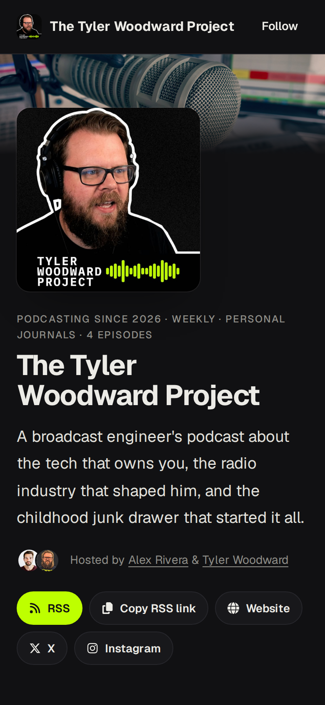

<p align="center">
  <picture>
    <source media="(prefers-color-scheme: dark)" srcset="docs/images/logo-dark.svg">
    
  </picture>
</p>

<p align="center">
  A free, self-hosted podcast studio: record lossless audio that survives a crashed tab,<br>
  publish an RSS feed and a public show site from your own server, and keep every file in your own storage.
</p>

<p align="center">
  
  
  
  <a href="LICENSE"></a>
</p>

> [!NOTE]
> Podstudio is **new and only partly built**. Solo recording, episodes, the RSS feed and the public
> site work end to end on one home server. The editor, remote guests, AI tools and analytics are
> still mock-ups. Recording has been qualified with a simulated microphone in Chromium only, not yet
> on real audio hardware. [What's real and what isn't](#whats-built-and-whats-not) lists it all.

<p align="center">
  
</p>

## What it does

| | |
|---|---|
| 🎙️ **Recording that doesn't lose audio** | 48 kHz mono 24-bit PCM captured in the browser, cut into 2-second chunks, written to a local journal and uploaded one by one. The server checks each chunk's hash and reads it back before it counts it as saved, and a finished take is a WAV assembled only from verified chunks |
| 🔁 **Retake with a tone** | Press <kbd>K</kbd> to mark a bad take: a 1 kHz tone is mixed into the recording and a sample-accurate marker is stored, so you can find the spot in the editor and by ear |
| 🛟 **Crash recovery** | Close the tab, lose the connection or kill the browser mid-take: reopen the screen and the take is recovered, with the exact length of anything that never got saved reported honestly |
| 📡 **RSS feed** | Apple/Spotify-ready feed with Podcasting 2.0 tags (`podcast:guid`, `locked`, `person`, funding, podroll, …). Only published, public episodes with verified audio are ever emitted. GUIDs are never regenerated once stored |
| 🗓️ **Scheduled publishing** | Pick a date and the worker publishes the episode on time (checks every 15 s, once, even across restarts) |
| 🌐 **Public show site** | Server-rendered pages with no cookies and no trackers: show header, per-episode artwork, a card grid, a site-wide player that keeps playing as you browse, hosts and guests, follow buttons, SEO tags and a sitemap |
| ✍️ **WYSIWYG show notes** | A rich-text editor in the studio (with an HTML view); the public pages render sanitized full HTML, including YouTube, Vimeo and Spotify embeds, with scripts, styles and forms always removed |
| 🧩 **Embeddable player** | An iframe (or `<div data-podstudio>` script) for one episode, the latest episode or the whole show, light/dark/auto, plus oEmbed |
| 🖼️ **Artwork pipeline** | Show, episode, host and header images are checked, stored under hash-named immutable URLs, and resized on first request |
| 🗄️ **Your storage** | Media goes to an S3-compatible bucket (a local Garage container is included); the database is a single SQLite file |

## Screens

| | |
|---|---|
|  |  |
| **Podcast hosting**: the feed URL with a copy button, a self-check of the feed, and what's actually in it | **Episode details**: the rich-text editor, credits, audio and a link to the public page |
|  |  |
| **Public episode**: player, show notes with chapter timestamps, and what to listen to next | **Embed player**: drop it on any site |

<p align="center"></p>

## Install

Podstudio runs as four containers (Caddy, the web app, a worker and Garage for storage).

```sh
cd deploy
cp .env.example .env
#   BETTER_AUTH_SECRET=$(openssl rand -hex 32)
#   PODSTUDIO_ADMIN_PASSWORD=<the first admin's password>
#   GARAGE_RPC_SECRET=$(openssl rand -hex 32)
docker compose up -d --build
```

On first boot the web container migrates and seeds the database, and creates the admin account from
`PODSTUDIO_ADMIN_PASSWORD` (it only reads it once; change the password in the app afterwards).
Caddy serves HTTPS for the hostname in `deploy/Caddyfile`, which is `studio.tylerwoodward.me` with
Caddy's internal CA. **Change that to your own hostname** before you use it, and trust Caddy's root
certificate on each device once.

Rebuild after a code change with the wrapper, which also clears the Docker build cache each rebuild
leaves behind (about 1 GB):

```sh
scripts/rebuild.sh web      # or: worker
```

> [!WARNING]
> Never run `docker system prune --volumes` on the host: it deletes the data volumes.

## Develop without Docker

```sh
corepack enable
pnpm install
export PODSTUDIO_DB_PATH=$PWD/data/podstudio.db
export BETTER_AUTH_SECRET=$(openssl rand -hex 32)
pnpm db:migrate && pnpm db:seed
PODSTUDIO_ADMIN_PASSWORD=whatever pnpm --filter @podstudio/web run seed:admin
pnpm dev                    # web on :3000, the worker alongside
```

```sh
pnpm typecheck
pnpm test                   # vitest: capture contract, chunk assembly, feed, scheduler, rich text, …
```

The seed fills in a demo show with placeholder episodes so you can see the screens; replace them with
your own.

## Recording, in detail

```
mic ─► AudioWorklet (no echo cancel / noise suppression / AGC)
        └─► 2 s chunks ─► IndexedDB journal ─► PUT /chunks/N ─► server: SHA-256 + size + read-back
                                                       └─► journal drops the chunk once verified
finish ─► server streams the verified chunks, in order, into one WAV ─► private raw storage
```

- A chunk is "saved" in three separate senses that the screen keeps apart: *saved on this computer*,
  *verified by the server*, and *finalized complete or incomplete*.
- A gap is never papered over: finalizing refuses if a chunk is missing unless you choose to finish
  with the gap, and then the take is marked incomplete with a report.
- If a local save ever fails (for example the browser's storage is full) the screen says so and shows
  how many seconds of audio exist only in that tab.
- Qualified so far with a simulated microphone: a 30-minute and a 2-hour run, checking the WAV header,
  duration, every chunk boundary, silent holes and the position of every retake tone. See
  [`docs/HANDOFF.md`](docs/HANDOFF.md) for the numbers, and [`validation/recording`](validation/recording)
  for the detached test runner.

## What's built and what's not

| Area | State |
|---|---|
| Sign-in, studio shell, server settings | Built |
| Episodes: create, edit, duplicate, delete, credits, audio upload | Built |
| Solo recording (Stage 03) | Built; not yet tried on real hardware or in Firefox/Safari. No pause/resume yet |
| RSS feed, feed overview and self-check, scheduled and manual publish | Built |
| Public show and episode pages, hosts and guests, SEO, embeds, oEmbed | Built |
| Show artwork, per-episode artwork, header image, brand and theme | Built |
| Multitrack editor, noise reduction, voice FX, MP3/WAV export | Not built (mock-ups only) |
| Remote guests, call recording | Not built |
| Analytics (OP3), Podcast Index, AI tools, transcripts | Not built; the screens say "No data" rather than faking it |
| Off-site backup | Not set up |

## How it's built

A pnpm + Turborepo monorepo: `apps/web` (React Router 8 on Express, React 19), `apps/worker`
(scheduler), and shared packages for the database (Drizzle + SQLite in WAL mode), the feed builder,
audio utilities and the UI kit. Auth is Better Auth with one admin account. Public pages set no cookies
and load no third-party scripts.

Start with [`docs/HANDOFF.md`](docs/HANDOFF.md) for the current state of every screen, then
[`CLAUDE.md`](CLAUDE.md) for the working rules. `docs/design/Podstudio v2.dc.html` is the visual
reference; open it in a browser.

## Made by

By [The Tyler Woodward Project](https://github.com/thetylerwoodwardproject). MIT licence.
