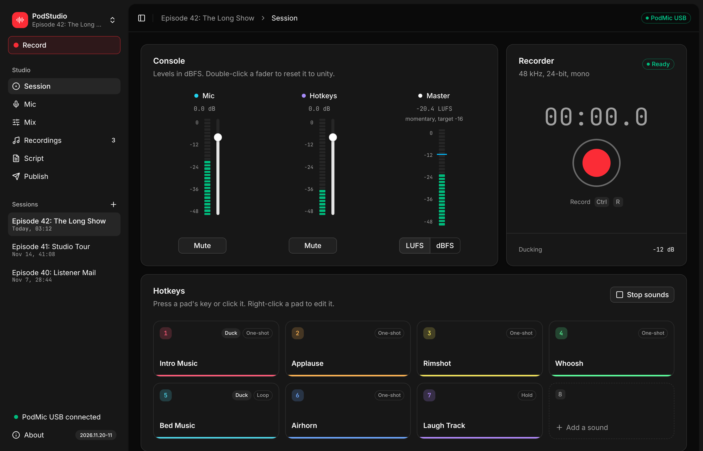
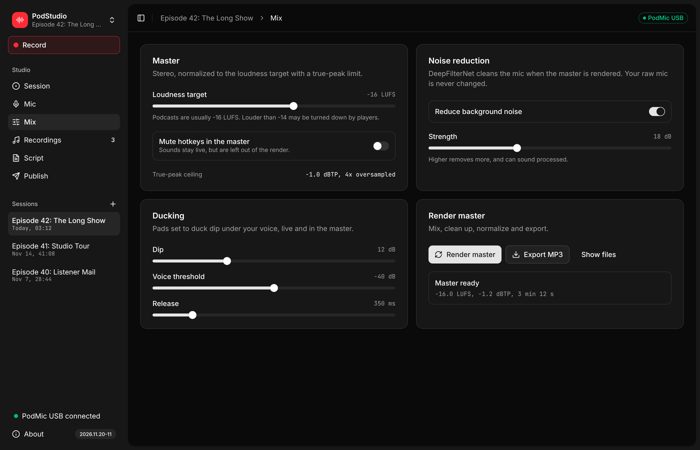

# PodStudio design mockup

A clickable mockup of the planned redesign: shadcn/ui components with a sidebar. It's a design reference for restyling the native app, not part of the app itself.





## Run it

```bash
cd design/mockup
npm install
npm run dev
```

All six sections open, Record starts a timer (Ctrl+R too), and the faders, switches and toggles work. Levels and content are sample data.

The components in `src/components/ui/` are shadcn/ui (MIT).
