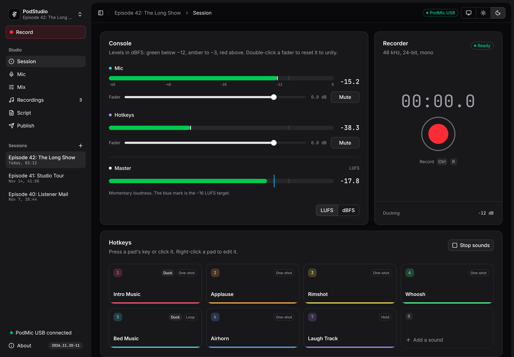
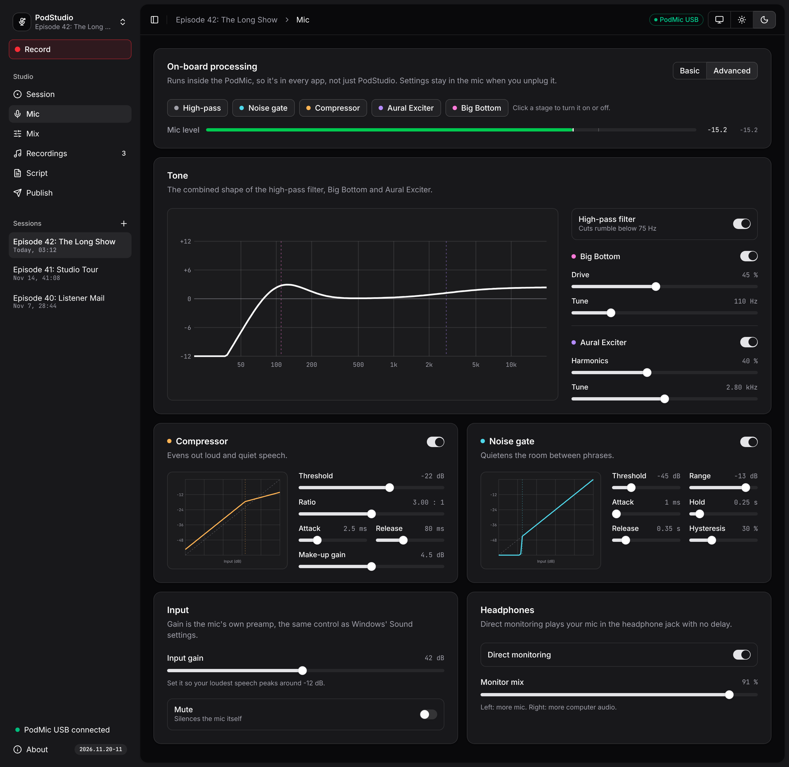
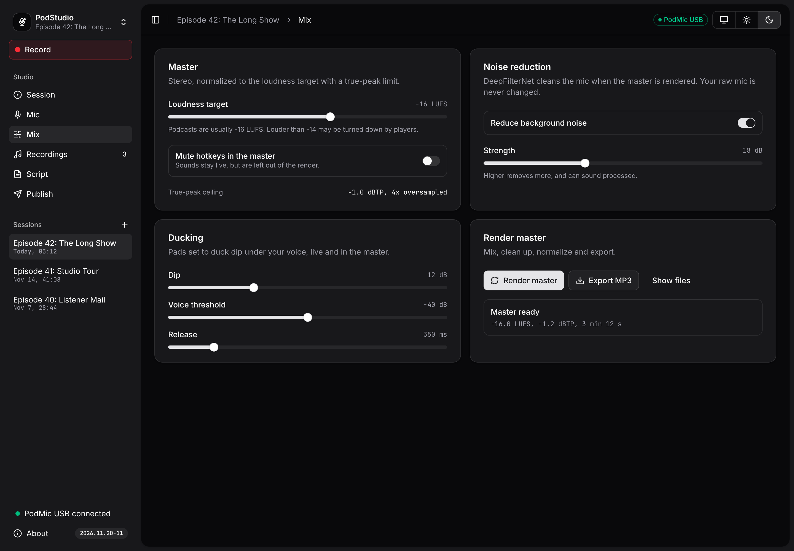

# PodStudio mockup

A clickable mockup built with [shadcn/ui](https://ui.shadcn.com) (zinc, Inter and JetBrains Mono). It is a design reference for the real app (native C++, for Windows, macOS and Linux), and is not part of it. All data is sample data.







## Screens

| Route | Screen | What it shows |
|---|---|---|
| `#/session` | Session | Console faders, recorder, hotkey pads |
| `#/mic` | Mic | Advanced mic stages with tone and dynamics curves |
| `#/mix` | Mix | Master loudness, noise reduction, ducking and render |
| `#/recordings` | Recordings | The session's recordings, with playback |
| `#/script` | Script | Script and prompter |
| `#/publish` | Publish | Episode details and Buzzsprout upload |

Dark and light, with a System / Light / Dark switch.

## Run it

```bash
cd docs/mockup
npm install
npm run dev          # http://localhost:5173
npm run build        # production build in dist/
npm run typecheck
```

## Screenshots

`shots.json` lists the screenshots (route, theme, size). To retake them:

```bash
npm install
npx playwright install chromium
npm run build
npm run screenshots  # writes screenshots/*.png
```

## Layout

The project has the same shape in every repo, so a change to the frame can be copied across.

| Path | |
|---|---|
| `src/components/ui/` | shadcn/ui components (MIT), added with `npx shadcn@latest add <name>`; `components.json` is already set up |
| `src/components/` | Shared pieces: `app-shell` (sidebar, header, breadcrumb), `page-header`, `stat-card`, `status-pill`, `level-meter`, `filter-chips`, `listen-bar`, `theme-toggle` |
| `src/index.css` | shadcn zinc tokens (light and dark) plus `success` and `warning` |
| `src/App.tsx` | Nav, sidebar status and routing for this product |
| `src/brand.ts`, `public/icon.svg` | The app icon: the sidebar glyph and tile colour, and the full-colour favicon (also in `docs/images/`) |
| `src/screens/` | One file per screen |
| `src/data.ts` | Sample data (where the screens share any) |
| `shots.json`, `scripts/screenshots.mjs` | Screenshot list and script |

Everything under `src/components/`, `src/lib/`, `src/hooks/`, `src/index.css` and `scripts/` is identical across the four repos. Keep it that way: change one, copy to the others.

The mockup is React because shadcn/ui is. The real UIs are not: use the matching library there ([shadcn-svelte](https://shadcn-svelte.com) for the Svelte web UIs) and the mockup's tokens and layout.
